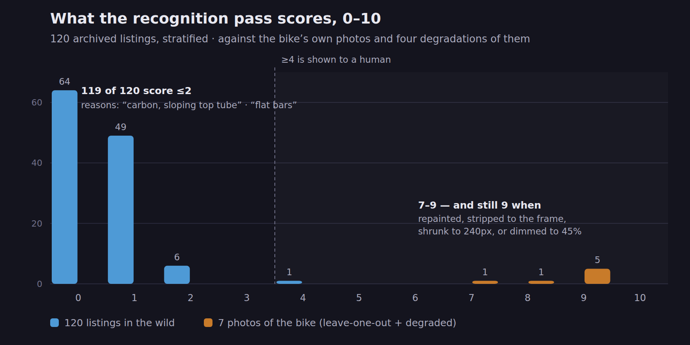
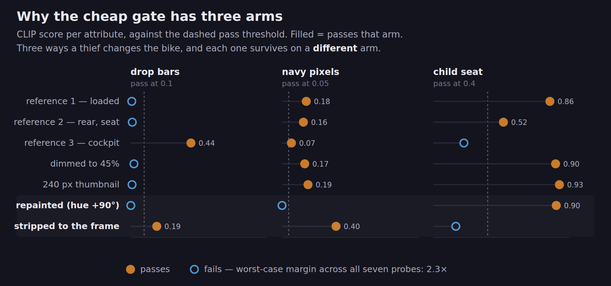
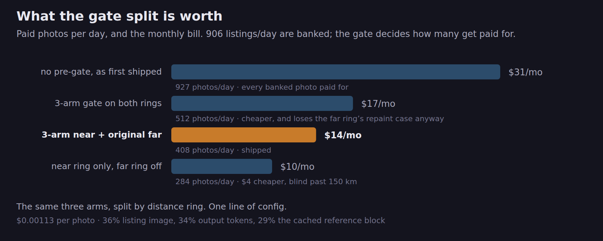

# stolen-bike-watch

My bike was stolen in Barcelona on 5 September 2026. Every piece of advice you
get is "set a keyword alert on the marketplaces." That advice does not work,
and this repo is what I built after measuring why.

**Thieves delete the brand.** A listing for your bike does not say
`Brand Model` — it says *"bicicleta de montaña, poco uso"*. Text matching has
nothing to match. So this stops searching text and starts showing you
**photographs**: every plausible bike listed near the theft site, ranked by how
much it looks like yours, delivered as a digest you can eyeball in twenty
seconds.

Running continuously since 5 Sept 2026 on Wallapop + Milanuncios: ~900 listings
a day scanned, archived, photo-scored, and cut down to **~4 photos a day** worth
a human look, for about **$14/month**.

Still looking. The bike has not turned up. What follows is the method, with its
own numbers, including the parts that did not work.

---

## The three channels

| | what it watches | volume | delivery |
|---|---|---|---|
| **HITS** | listings whose *text* names the brand or a model | rare | pushed within 20 min, with the photo |
| **SWEEP** | *every* bike near the theft site in the price band | ~900/day | photo digest, 6×/day, ranked |
| **PARTS** | the kit that comes off a stripped bike, clustered **by seller** | ~11/day | one digest/day |

HITS is the channel you want. SWEEP is the channel that works. PARTS exists
because stripping is the economically rational way to dispose of a bike — one
account selling a child seat, a rack and a pannier inside a fortnight is a bike
that came apart.

## Why the photo pass is two passes, not one

The honest version of "find my bike by image match" is: **it does not work off a
marketplace thumbnail**, and I have the numbers for that in
[`docs/VISION.md`](docs/VISION.md). What *does* work is a two-stage pass where
each stage is doing a job it is actually good at.

**Stage 1 — CLIP attributes (free, local).** Scores every photo for the three
things that are true about my bike and rarely true together: drop handlebars ·
navy pixels · a child seat. It is an *attribute* filter, not an identification.
Used as the only filter it fails in a way worth knowing about: of 120 archived
listings, the entire top of its ranking is modern carbon race bikes, because
"is this a road bike" is the only question it was ever asked.

**Stage 2 — a vision LLM (paid, ~$0.0011/photo).** Sends the photo to Claude
alongside three reference photos of the actual bike and asks for a 0–10
plausibility score *and a one-line reason*. Measured on 120 stratified archive
listings: **119 score ≤2**. The bike's own photos score **7–9** — and still
score **9** when repainted, stripped to the bare frame, shrunk to a 240 px
thumbnail, or dimmed to 45% brightness. Those four are not hypotheticals; they
are what a thief does before listing.

That separation — a hard floor at 2 for the world, a hard floor at 7 for the
bike — is the whole product. It is what turns 900 photos a day into 4.



**Stage 1 then earns its place back as a pre-gate.** Rejecting the cheap filter
as a *ranker* is not the same as rejecting it as a *gate*. Once the three CLIP
arms are calibrated against deliberately degraded reference photos, each failure
mode turns out to be covered by a different arm — a repainted bike survives on
the child-seat arm alone, a stripped one on navy/dropbar alone — so a 3-arm OR
gate cuts 44% of the paid calls with a worst-case margin of 2.3× and kills
nothing the LLM would have scored ≥3. That one split is the difference between
**$31/month and $14/month**.





Both passes, every threshold, and the probe tables they are calibrated against
are in [`docs/RECOGNITION.md`](docs/RECOGNITION.md). Do not move a number
without re-running the table under it.

## Things that were tried and rejected, with the cost of each

Kept here because a repo that only lists its wins is not telling you anything.

| lever | saving | why it was rejected |
|---|---|---|
| Batch 12 photos per request | −43% | **5× the false positives.** The model starts comparing listings to each other instead of to the references. |
| Drop the `reason` field, score only | −29% | **Costs recall.** The hardest near-miss probe fell from 7 to 3. The reason field is doing reasoning work, not decoration. |
| A cheaper model (Haiku 4.5) | — | Scored the bike, loaded with its own child seat, a **2/10** — and cost *more*, because our reference prefix sits under its minimum cacheable size, so nothing cached. |
| Narrow the price band | −19% | A thief prices unpredictably. Not worth the recall. |
| "Be strict" in the prompt | — | Collapsed 116/120 scores to exactly 0, including all three reference photos, **and still produced two false positives at 8**. |

## Install

```bash
git clone https://github.com/mintcloud/stolen-bike-watch && cd stolen-bike-watch
python3 -m venv .venv && .venv/bin/pip install -r requirements.txt
cp .env.example .env                      # NOTIFY_BACKEND=stdout needs nothing else
cp data/bike.example.json data/bike.json  # fill in: centre, price, brand/model
./set-bike.sh "Brand Model gravel negra talla M 2023" 1800   # or guess it for me

./run.sh --test        # one pass, prints, writes no state, sends nothing
```

Then, for the photo pass:

```bash
python3 -m venv .venv-vision && .venv-vision/bin/pip install fastembed pillow numpy requests
mkdir -p data/reference-photos   # 3 photos of the bike: drive side, rear, cockpit
./visual.py refs                 # what the references score on each CLIP arm
./vlm.py refs                    # leave-one-out LLM scores -- sanity before cron
```

A photo of the bike **against a blue wall will poison the navy arm** — it
credits the background. Shoot one against something neutral.

### Cron, as it actually runs

```cron
*/20 * * * *                 run.sh --send          # scan: push hits, bank the sweep
15 8,11,14,17,20,23 * * *    run.sh --digest        # flush the bank, ranked
5,25,45 * * * *              run-milanuncios.sh --send
35 * * * *                   run-accessories.sh --scan
40 9 * * *                   run-accessories.sh --digest
```

Twenty minutes is not a preference, it is a **floor**: `order_by=newest` is
national, and five pages of `bicicleta` only reaches back ~39 minutes. Stretch
the interval and listings vanish between runs with nothing looking wrong, which
is why `sweep_scan()` measures its own coverage window and logs
`WARNING: coverage gap of N min` when it starts happening.

## Marketplace notes you would otherwise learn the hard way

Wallapop has no public API. This calls the same unauthenticated endpoint the web
app calls, read-only — no account, no login, no messaging, ~14 requests per
scan. If you port this to another marketplace, these are the traps:

- **The CDN WAF 403s a bare request.** `Origin` + `Referer` + `X-DeviceOS` are
  what make it answer.
- **`distance` and `category_ids` are silently ignored.** `distance=20000` still
  returns results 600 km away. All geo and category filtering is done
  client-side off `location.latitude/longitude`. More reliable anyway.
- **Responses are CDN-cached per full URL** — hence the cache-buster.
- **The bike category includes wheels, helmets and frames.** Accessories are
  dropped, but **frames are kept**: a stripped frame is exactly what a thief
  sells.
- **Never hand Telegram an image URL.** Telegram's fetcher creates a photo
  record its CDN then refuses to serve to the *desktop* client — it stalls at 0%
  forever while mobile looks fine (proven with a 9-cell test matrix). Worse,
  `sendMediaGroup` is all-or-nothing, so one image it refuses silently drops the
  whole batch of ten while the log still says "94 shown of 94". That cost 107
  listings across 14 of 78 digests before it was found. Download the bytes here
  and upload them.

## What this cannot do, and what not to do with it

It cannot tell you a listing **is** your bike. It tells you a photo is
plausibly a navy steel drop-bar bike, and on an ordinary day in a big city that
is nobody. The recognition stays yours; the job of the pipeline is to make sure
the handful of photos you look at are the handful worth looking at.

If something looks right: **add it to your existing police report.** Do not
message the seller, do not arrange a meet, do not go yourself. The repo
deliberately has no way to contact anyone — it only ever reads public listings.

## Layout

```
wallapop_monitor.py   the scanner, the scoring, the senders   (all channels funnel here)
milanuncios.py        second marketplace, same senders
accessories.py        the parts channel, clustered by seller
visual.py             CLIP attribute pass            (.venv-vision)
vlm.py                the recognition pass + cost ledger
contact-sheet.py      the archive as one dark HTML photo grid
recover-backlog.py    re-send the best-scoring archived listings
notify.py             telegram | stdout | webhook
docs/VISION.md        what image matching can and cannot do, measured
docs/RECOGNITION.md   the LLM pass: precision, recall, cost, rejected levers
docs/LOGIC.md         the search-widening changes and the filter traps
data/                 gitignored. Your bike, your coordinates, your archive.
```

MIT. If you are reading this because it just happened to you: file the report,
photograph everything you still have, and check the serial on your receipt.
